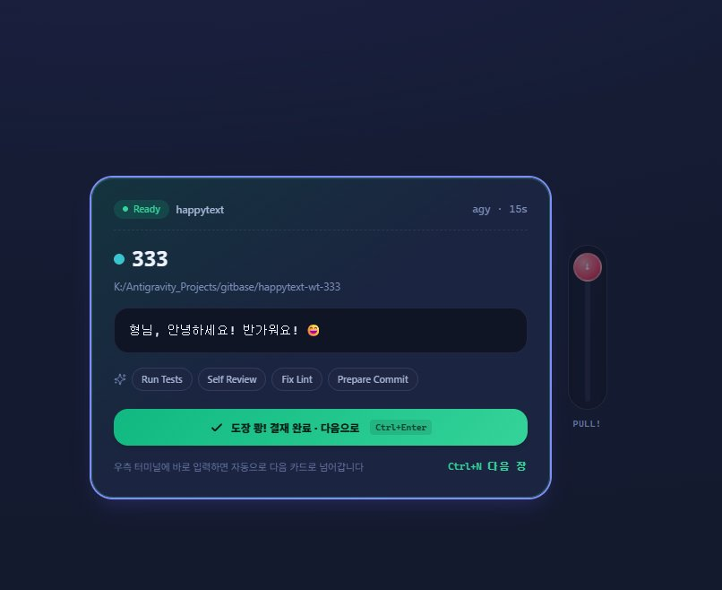
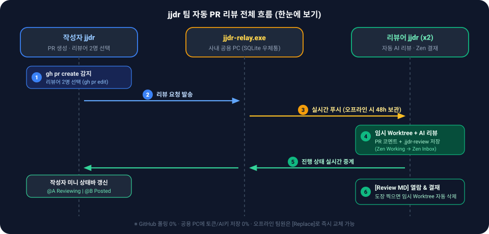

# jjdr (`jj + herdr`)

멀티 프로젝트 · Git Worktree · AI CLI(`agy`, `claude`, `gemini`, `codex`)를 한눈에 관제하는 초경량 **Tauri v2** 데스크톱 앱입니다.

## 핵심 기능
- **3단 관제 뷰 (`Radar` · `Queue` · `Zen`)**: 전체 프로젝트/Worktree 현황(`Radar`), 우선순위 할 일 인박스(`Queue`), 최상단 1장 집중 처리(`Zen`)를 `Ctrl+1/2/3`으로 즉시 전환
- **백그라운드 최우선 카드 알림 (HUD)**: 앱이 백그라운드에 있을 때 가장 급한 카드(`Needs You` → `Ready`)를 포커스 방해 없이 화면에 크게 표시 *(설정에서 ON/OFF · 중앙 상단(기본)/중앙 하단/우하단 위치 선택 · 미리보기 지원, 클릭 시 해당 카드로 즉시 이동)*
- **Worktree 다중 세션 & 논블로킹 작업**: 하나의 Worktree에서 AI CLI와 PowerShell을 동시에 열고 `Ctrl+Tab`으로 전환하며, Worktree 생성/삭제 및 새 세션 추가는 0ms 즉시 백그라운드로 진행
- **빠른 파일 검색 & 내장 뷰어 (`Ctrl+P`)**: 프로젝트별 백그라운드 인덱스 기반 Fuzzy · Glob(`*.cpp`) · Regex 초고속 검색과 내장 코드(구문 강조)/Markdown(GFM) 뷰어 제공
- **초경량 하이브리드 터미널 & 무손실 복원**: 평소 관제는 `xterm.js` 0개 + Zero-Blur UI로 가볍게 유지하고, 앱을 닫아도 `herdr-core` 위 AI 세션은 그대로 살아 있으며 재실행 시 자동 복원
- **커스텀 테마 & 레이아웃**: 4종 내장 테마(`Aurora Dusk` 기본 / `Warm Lounge` / `Nordic Mist` / `Botanical Slate`), 한 줄 카드 밀도(`3/2` · `4/2` · `5/3`), 카드 별칭/메모 및 1:1 자리 교환 지원
- **팀 자동 PR 리뷰 (`Team Orchestration`)**: `gh pr create` 자동 감지 → 리뷰어 2명 지정 → 사내 공용 PC 경량 Relay(`jjdr-relay`)로 임시 리뷰 Worktree 자동 실행 & 실시간 상태바·Zen MD 열람 ([사용 가이드](docs/team_auto_review_guide_2026-11-27.md) · [Relay 서버 가이드](relay/README.md))

## Zen 모드 (`Ctrl + 3`)

여러 AI를 동시에 돌릴 때 인지 부하를 줄이고, **지금 확인이 필요한 최상단 카드 1장만** 차례대로 결재·응답할 수 있는 집중 모드입니다.

- **최상단 1장 집중 + Sticky Lock**: 처리 중인 카드를 고정해 다른 세션의 백그라운드 알림에 방해받지 않고 작업 완료
- **우측 터미널 자동 연결 & 즉시 포커스**: 새 카드가 올라오면 우측 터미널이 자동 연결·포커스되어 바로 키보드 입력 가능
- **도장 쾅 결재 & 물리 컨트롤**: `Ctrl+Enter` 버튼이나 우측 아케이드 볼 레버 / 가챠 다이얼로 카드를 시원하게 결재하고 다음 카드로 전환 *(보류 순환은 `Ctrl+N`)*
- **All Clear 브리핑**: 쌓인 확인 요청이 0건이 되면 우측 터미널을 자동으로 접고, 현재 진행 중인 작업(카드명 · 프로젝트 · 브랜치)과 오늘 클리어 현황을 한눈에 표시

## 팀 자동 PR 리뷰 (`Team Orchestration`)

👉 **[3분 세팅 & 사용 가이드](./docs/team_auto_review_guide_2026-11-27.md)** · **[공용 PC Relay 서버 가이드](./relay/README.md)**

## 설치 및 실행 방법

### 1. `herdr` 설치 (필수)
`jjdr`는 백그라운드 터미널 데몬인 `herdr-core` (`hc` CLI) 위에서 동작합니다. 먼저 아래 페이지에서 `herdr`를 설치해 주세요.
- 공식 사이트: https://herdr.dev
- GitHub 저장소: https://github.com/herdrdev/herdr-core

### 2. `jjdr` 최신 릴리즈 설치
GitHub Releases에서 최신 Windows 설치 파일(`.exe` 또는 `.msi`)을 내려받아 설치 후 실행하세요.
- 👉 **[최신 릴리즈 다운로드 (Releases / Latest)](https://github.com/sindng-ui/jjdr/releases/latest)**

## 주요 단축키

| 단축키 | 동작 |
| :--- | :--- |
| `Ctrl + 1` / `2` / `3` (또는 `Ctrl + M`) | `Radar` / `Queue` / `Zen` 뷰 즉시 전환 |
| `Ctrl + N` | 다음 확인 필요한 세션(`Action` → `Ready`)으로 이동 *(Zen에서는 현재 카드 보류/다음 장)* |
| `Ctrl + Enter` | *(Zen 모드)* 현재 카드 도장 결재 완료 후 다음 카드로 전환 |
| `↑ ↓ ← →` / `Ctrl + ↑↓←→` | 2D 카드 이동 *(터미널 열림 시 `Ctrl+방향키`로 이동 + 터미널 자동 전환·포커스)* |
| `Ctrl + Shift + Alt + ↑↓←→` | 선택한 카드와 인접 카드 1:1 자리 교환 |
| `Ctrl + \`` | 우측 터미널 패널 열기 / 닫기 *(대기 카드에서는 기본 AI 바로 실행)* |
| `Ctrl + Tab` / `Ctrl + Shift + Tab` | 현재 Worktree의 AI ↔ Shell 세션 탭 전환 |
| `Ctrl + Shift + T` / `A` | 현재 Worktree에 새 PowerShell 탭 / AI 세션 추가 |
| `Alt + Enter` | 선택한 카드 컨텍스트 메뉴 열기 *(키보드 풀 제어)* |
| `Ctrl + P` | 빠른 파일 검색 *(Fuzzy · Glob · Regex + 내장 코드/MD 뷰어)* |
| `Ctrl + F` / `Ctrl + K` | 상단 검색창 포커스 / 커맨드 팔레트 |
| `Ctrl + B` / `Esc` | 좌측 사이드바 토글 / 모달·터미널·필터 순차 해제 |
