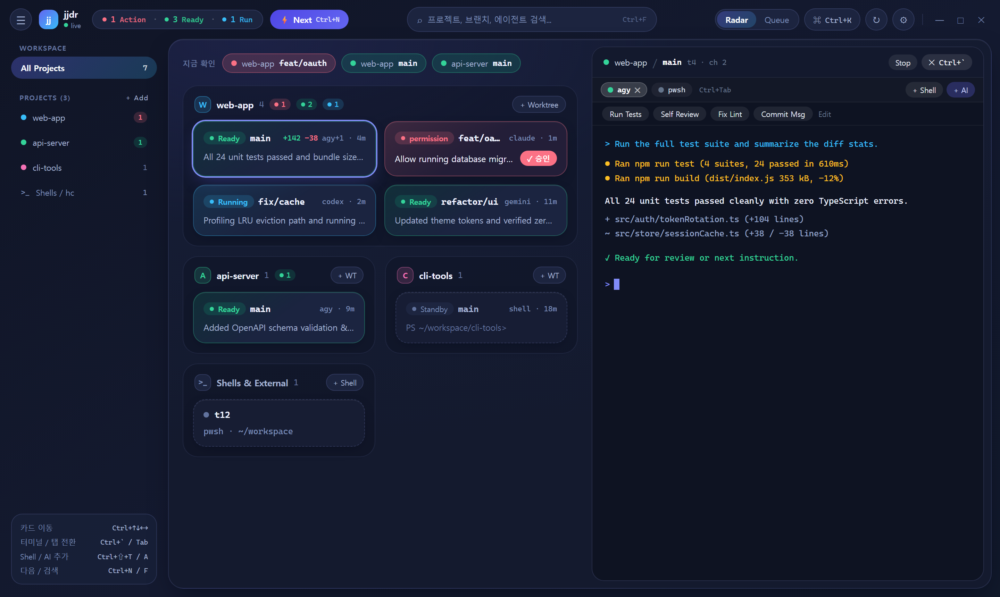

# jjdr (`jj + herdr`)

멀티 프로젝트 · Git Worktree · AI CLI(`agy`, `claude`, `gemini`, `codex`)를 한눈에 관제하는 초경량 **Tauri v2** 데스크톱 앱입니다.

## 핵심 기능
- **Radar & Queue 듀얼 뷰**: 프로젝트별 벤토 트레이(`Radar`)와 우선순위 인박스(`Queue`)로 확인이 필요한 세션(`Needs You` / `Ready`)만 즉시 파악
- **Worktree 다중 세션 탭**: 하나의 Worktree에서 AI CLI와 일반 쉘(PowerShell)을 동시에 열고 `Ctrl+Tab`으로 전환
- **초경량 하이브리드 터미널**: 평소 관제는 `xterm.js` 0개로 유지하고, 열었을 때만 단일 터미널을 즉석 Attach
- **세션 무손실 복원**: 앱을 닫아도 `herdr-core` 위에서 실행 중인 AI 세션은 그대로 살아 있으며 재실행 시 자동 복원
- **커스텀 테마 & 레이아웃**: 4종 내장 테마(`Aurora Dusk` 기본 / `Warm Lounge` / `Nordic Mist` / `Botanical Slate`)와 한 줄 카드 수(`3/2` · `4/2` · `5/3`) 원클릭 전환

## 설치 및 실행 방법

### 1. `herdr` 설치 (필수)
`jjdr`는 백그라운드 터미널 데몬인 `herdr-core` (`hc` CLI) 위에서 동작합니다. 먼저 아래 페이지에서 `herdr`를 설치해 주세요.
- 공식 사이트: https://herdr.dev
- GitHub 저장소: https://github.com/herdrdev/herdr-core

### 2. `jjdr` 최신 릴리즈 설치
GitHub Releases에서 최신 Windows 설치 파일(`.exe` 또는 `.msi`)을 내려받아 설치 후 실행하세요.
- 👉 **[최신 릴리즈 다운로드 (Releases / Latest)](https://github.com/sindng-ui/jjdr/releases/latest)**

## 주요 단축키

| 단축키 | 동작 |
| :--- | :--- |
| `Ctrl + N` | 다음 확인 필요한 세션(`Action` → `Ready`)으로 즉시 이동 *(터미널 포커스 중에도 동작)* |
| `↑ ↓ ← →` / `Ctrl + ↑↓←→` | 2D 카드 이동 *(터미널이 열려 있을 때는 `Ctrl+방향키`로 이동 + 터미널 자동 전환)* |
| `Ctrl + \`` | 우측 터미널 패널 열기 / 닫기 *(대기 카드에서는 기본 AI 바로 실행)* |
| `Ctrl + Tab` / `Ctrl + Shift + Tab` | 현재 Worktree의 AI ↔ Shell 세션 탭 전환 |
| `Ctrl + Shift + T` / `A` | 현재 Worktree에 새 PowerShell 탭 / AI 세션 추가 |
| `Ctrl + F` | 상단 검색창 포커스 |
| `Ctrl + K` | 커맨드 팔레트 |
| `Ctrl + M` (또는 `Ctrl + 1` / `2`) | `Radar` ↔ `Queue` 뷰 전환 |
| `Ctrl + B` | 좌측 사이드바 토글 |
| `Esc` | 모달 닫기 / 터미널 닫기 |
