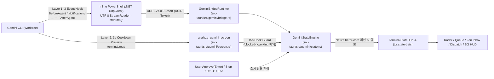

# Gemini CLI 내장 상태 브릿지 실전 핸드북 & 트러블슈팅 가이드

> 작성일: 2026-11-27 | 대상 버전: `jjdr` v0.4.4+  
> 목적: 내일 회사 환경(보안 프로그램 AV/EDR + 실제 사내 인증 Gemini CLI)에서 실전 투입 시 **3분 안에 원인을 파악하고 즉시 보강**할 수 있도록 구현·검증·조치 내역과 대응 플레이북을 집약한 운영 문서.

---

## 1. 아키텍처 & 동작 흐름

`herdr-core`가 Gemini CLI 상태를 아직 네이티브로 채워주지 않으므로(`status: null, turn: 0`), `jjdr` 내부에 **초경량 2-Layer 상태 브릿지**를 내장하여 `TerminalStateHub`에서 `herdr-core`와 100% 동일한 `Status` / `turn` 구조로 오버레이합니다.



### 회사 보안 프로그램(AV/EDR) 성능 최적화 4대 원칙
1. **3-Event 최소화**: `BeforeAgent`, `Notification`, `AfterAgent` 딱 3개만 등록. 작업 중 수십 번 도는 `BeforeTool` / `AfterTool` 훅은 **0개** (도구 호출 루프 오버헤드 0).
2. **Windows 추가 프로세스 스폰 0회**: Gemini CLI가 훅 실행 시 이미 띄우는 `pwsh` / `powershell` 안에서 `.NET UdpClient`로 fire-and-forget 전송. 추가 `node.exe` 스폰 0, TCP 핸드셰이크 0, `.ps1` ExecutionPolicy 우회.
3. **타임아웃 여유 + 무에러 침묵 종료**: `timeout: 5000ms` (AV 콜드스타트 지연 대응), `jjdr` 종료 상태거나 파일 깨짐에도 항상 `exit=0`, `stdout="{}"`, `stderr=""`.
4. **원클릭 Screen-Only 모드 (0 Hooks)**: **Settings → Gemini CLI Status Bridge → `Screen-Only Mode (0 Hooks)`** 클릭 시 `~/.gemini/settings.json`에서 훅을 제거하고 `hooks_disabled.flag`를 남겨 재실행 시에도 훅 없이 Layer-2 화면 파서만으로 동작.

---

## 2. 파일 구조 & 수정 포인트 빠른 참조표

회사에서 문제가 생겼을 때 **어느 파일을 열어야 하는지** 한눈에 찾는 지도입니다.

| 파일 | 역할 | 보강할 때 열어볼 상황 |
| :--- | :--- | :--- |
| `src-tauri/src/gemini/mod.rs` | 도메인 타입 & `is_gemini_terminal()` 판별 | 회사 Gemini 실행 바이너리명/래퍼(`gemini-corp`, 커스텀 `node` 경로 등)가 인식 안 될 때 |
| `src-tauri/src/gemini/installer.rs` | `~/.gemini/settings.json` 비파괴 3-Event 훅 병합/제거 & 인라인 PowerShell 생성 | 회사 PowerShell 정책(`ConstrainedLanguageMode`), 훅 `timeout`, 훅 커맨드 수정 필요 시 |
| `src-tauri/src/gemini/bridge.rs` | `127.0.0.1:0` UDP 리스너, 토큰 검증, 이벤트→`Status` 매핑(`map_hook_packet_to_status`) | 회사 Gemini가 새로운 `hook_event_name`이나 `notification_type`을 보낼 때 |
| `src-tauri/src/gemini/state.rs` | 순수 상태 머신(`GeminiStateEngine`): 3단계 매칭, 승인/취소 즉시 전이, 15초 가드, 역전/중복 방어 | 세션 매칭 규칙, 승인 후 해제, `turn` 증가 정책 수정 시 |
| `src-tauri/src/gemini/state_tests.rs` | `GeminiStateEngine` 단위·적대적·절망 테스트 (13 TC) | 새 상태 전이 버그 발견 시 회귀 TC 추가 |
| `src-tauri/src/gemini/screen.rs` | Layer-2 TUI 화면 파서 (`analyze_gemini_screen`) + 13 TC | 회사 Gemini CLI 버전의 확인창/스피너/입력창/에러 문구가 다를 때 |
| `src-tauri/src/commands/gemini_bridge.rs` | 진단/설치/제거/자가테스트 Tauri 커맨드 4종 | Settings UI 진단 필드 추가 시 |
| `src-tauri/src/commands/terminals.rs` | `launch_session` 태그 주입(`jjdr.gemini_tag`/`JJDR_GEMINI_ADDR`), `send_terminal_keys`(Enter 승인), `interrupt_terminal`(Stop 취소) | 승인 키나 중단 동작 보강 시 |
| `src-tauri/src/commands/worktrees.rs` | `create_worktree_and_launch` 시 Gemini 태그/env 주입 | Worktree 생성 직후 Gemini 매칭 이슈 시 |
| `src-tauri/src/commands/attach.rs` | `write_terminal_input`에서 Enter(`\r`/`\n`), `Ctrl+C`(`\x03`), 단독 `Esc`(`\x1b`) 감지 | 우측 터미널 직접 입력 시 상태 동기화 보강 시 |
| `src-tauri/src/herdr/events.rs` & `preview.rs` | `TerminalStateHub` 오버레이 & `terminal.read` → `apply_gemini_screen_fallback` 연결 | 폴링 주기(현재 `sync_terminals_now` 8초 / `preview` 3초 쿨다운) 조정 시 |
| `src/components/modals/GeminiBridgeSettingsSection.tsx` | Settings 내 상태·포트·이벤트 진단 및 원클릭 전환 UI | 회사 현장 진단 정보 표시 보강 시 |
| `src/utils/geminiSimulation.test.ts` | Frontend 전체 파이프라인(Radar/Queue/Zen/Dispatch/HUD) 가상 시나리오 + 절망/스트레스 테스트 (11 TC) | UI 버킷/알림/HUD 회귀 검증 시 |

### 런타임 주요 파일 경로 (Windows)
- Gemini 사용자 훅 설정: `%USERPROFILE%\.gemini\settings.json`
- 브릿지 포트/토큰 파일: `%APPDATA%\jjdr\gemini-bridge\endpoint.json`
- Screen-Only 옵트아웃 플래그: `%APPDATA%\jjdr\gemini-bridge\hooks_disabled.flag`

---

## 3. 사전 감사·적대적·절망 테스트로 이미 잡아내어 조치한 7대 실전 버그

내일 회사에서 밟았을 치명적 지뢰 7개를 오늘 미리 재현·적발하여 패치하고, **모두 자동 회귀 TC로 봉인**해 두었습니다.

| # | 발견 경위 | 실전 장애 증상 | 근본 원인 | 적용된 패치 | 봉인된 회귀 TC |
|---|---|---|---|---|---|
| 1 | **실측 재현** (적대적) | 한국어 Windows에서 한글 폴더명(`cwd`)·한글 답변(`prompt_response`)이 `?꾨줈?앺듃`로 깨지고 UDP 매칭/요약 실패 (`pwsh` & `powershell 5.1` 둘 다) | `[Console]::In.ReadToEnd()`가 시스템 기본 인코딩(CP949)으로 UTF-8 stdin을 읽음 | `New-Object IO.StreamReader([Console]::OpenStandardInput(), [Text.Encoding]::UTF8)` + `[IO.File]::ReadAllText(..., UTF8)` + 이모지 UTF-16 서로게이트 경계 안전 절단 | `installer::tests::windows_inline_powershell_hook_sends_valid_udp_and_clean_stdout` (pwsh + PS 5.1 양쪽 검증) |
| 2 | **코드 감사** (적대적) | 확인 다이얼로그 선택 커서가 `> Allow once` / `❯ Allow once`로 표시될 때 권한 프롬프트 감지가 100% 무력화 | `screen.rs`가 `> ` / `❯`를 "입력창 복귀"로 오탐해 `!bottom_has_active_input` 조건이 false가 됨 | `is_strict_input_bar_line()` 분리 — 확인 옵션 줄과 코드 diff `> code` 줄을 입력창 판정에서 엄격 제외 | `screen::tests::adversarial_radio_cursor_gt_or_chevron_on_allow_once_still_detects_blocked` |
| 3 | **코드 감사** | `Approve(Enter)` 승인 후에도 `AfterAgent`까지 카드가 `blocked` + Approve 버튼에 고착 | `BeforeTool`/`AfterTool`을 뺐고 15초 `recent_hook` 가드가 화면 파서까지 차단 | `send_terminal_keys` / `write_terminal_input` Enter 전송 시 즉시 `blocked → working` 해제 + 화면 파서 `blocked → working` 15초 가드 예외 | `state::tests::full_single_turn_hook_lifecycle_with_permission_and_user_approval`, `screen_fallback_respects_15s_hook_window_except_blocked_recovery` |
| 4 | **번들 대조** | 최신 `@google/gemini-cli` v0.3x 확인창 미감지 & 과거 스크롤백의 옛 `Allow execution` 오탐 | 최신 CLI는 멀티라인 `Allow once` / `Allow for this session` / `No, suggest changes (esc)` 사용 + 짧은 답변 후 옛 확인창이 18줄 안에 잔존 | 멀티라인 옵션 쌍 매칭 + 하단 4줄 활성 입력창 우선 규칙 + 회사 AV 대응 `timeout: 5000ms` 상향 | `screen::tests::detects_modern_v03x_multiline_allow_once_confirmation`, `ignores_historical_permission_in_scrollback_once_input_prompt_returns` |
| 5 | **코드 감사** (적대적) | 작업 중 `Ctrl+C`/Stop 취소 또는 `Esc` 거절 시 입력창 복귀를 `done(Ready)` 결재 카드로 오분류 | 중단 입력 시 상태가 `working`/`blocked`로 남아 화면 파서가 `done` 전이 | `apply_user_interrupt` 추가 (`interrupt_terminal`, `\x03`, 단독 `\x1b` — 화살표 `\x1b[A` 제외) → 턴 증가 없이 즉시 `idle` | `state::tests::adversarial_interrupt_and_esc_cancel_return_to_idle_without_false_ready` |
| 6 | **절망 감사** | 메모장/PS 5.1이 저장한 **UTF-8 BOM** `~/.gemini/settings.json`에서 훅 설치 100% 실패 | `serde_json::from_str`는 `\u{feff}` BOM을 에러 처리 | `trim_start_matches('\u{feff}')` 적용 + 깨진 JSON 파일 발견 시 원본 1바이트도 덮어쓰지 않고 안전 에러 반환 | `installer::tests::despair_handles_utf8_bom_and_malformed_hook_shapes_without_data_loss`, `despair_refuses_to_overwrite_corrupted_json_settings_file` |
| 7 | **절망 감사** | 역전된 옛 UDP 패킷이 완료 상태를 덮어쓰거나, 중복 `AfterAgent`가 `turn`을 2번 올려 이미 결재한 카드 재부활 + 답변 본문 `"API error"` 오탐 | 타임스탬프 단조성/중복 `done` 체크 부재 + 느슨한 `api error` 부분문자열 매칭 | `ts < prev.status_ms` 거부, `done→done` 중복 `bump_turn` 차단, 명시적 에러 배너 패턴만 `error` 판정 | `state::tests::despair_rejects_out_of_order_stale_packets_and_deduplicates_double_after_agent`, `screen::tests::despair_prose_mentioning_api_error_before_prompt_triggers_done_not_error` |

---

## 4. 구축된 테스트 Suite & 재실행 커맨드

내일 회사에서 코드를 보강한 뒤 아래 2줄만 돌리면 **총 154개 자동 테스트(Gemini 전용 48개)**로 회귀 여부를 15초 안에 검증할 수 있습니다.

```powershell
# 1. Rust 전체 단위 + 적대적 + 절망 + Windows pwsh/PS5.1 실측 UDP E2E (67 tests) + 전체 컴파일 체크
cargo test --manifest-path src-tauri/Cargo.toml --lib && cargo check --manifest-path src-tauri/Cargo.toml

# 2. Frontend 전체 단위 + Gemini 가상 시나리오/절망/100세션 스트레스 (87 tests) + TS/Vite 빌드
npm run test && npm run build
```

### 현재 커버리지 요약 (2026-11-27 기준)
- **Rust Backend (`67/67 PASS`, `cargo check` 0 errors / 0 code warnings)**:
  - `gemini::state` (`state_tests.rs`): 13 TC (풀 라이프사이클, 듀얼 Gemini 태그 매칭, Windows 대소문자/슬래시 CWD, 멀티턴, 15초 가드+`blocked` 예외, 0-Hook Screen-Only, 네이티브 양보, 비-Gemini/종료 격리, `Ctrl+C`/`Esc` 취소, 외부 `node.exe` 실행, 역전/중복 패킷, 애매한 CWD 타이브레이크, 크래시 미부활)
  - `gemini::screen`: 13 TC (구버전/v0.3x 멀티라인 확인창, `>`/`❯`/`●` 라디오 커서, 스크롤백 오탐 차단, `> code` diff 오탐 차단, ANSI PTY 파싱, `Waiting for model`/`MCP`, `working→done`, 일반 문장 `"API error"` 오탐 차단, 4종 에러, 50,000줄 폭주 로그 + Null 바이트 성능)
  - `gemini::installer`: 7 TC (비파괴 병합/제거, 3-Event 엄격 제한 & `5000ms` 검증, 공백/작은따옴표 경로 이스케이프, UTF-8 BOM & 기형 JSON 복구, 깨진 JSON 원본 보호, **Windows `pwsh` + `powershell 5.1` 실측 UDP E2E**(한글/이모지/서로게이트 절단/600자 절단/100KB 페이로드/깨진 stdin/깨진 endpoint/닫힌 포트))
  - `gemini::bridge`: 4 TC (전 이벤트 매핑, 토큰 검증, 권한 vs 질문 분기 & 폴백, 알 수 없는 이벤트 무시)
- **Frontend (`20 files, 87/87 PASS`, `tsc && vite build` 0 errors)**:
  - `src/utils/geminiSimulation.test.ts`: 11 TC (풀 라이프사이클 Radar/Queue/Zen/Approve/HUD, 멀티턴 재등장, 듀얼 Gemini+PowerShell 공존, Zen Dispatch 출동, **Claude vs Gemini 5종 상태 100% Parity**, Error Approve 비노출, `msg: null` 권한, 45분 Stuck 비난입 & 95% 상한, 크래시 `exit_code=137`, 미래 타임스탬프/음수 턴 `NaN` 방어, **50 Worktree × 98 Gemini 동시 스트레스 ~13ms**)

---

## 5. 내일 회사 실전 트러블슈팅 & 즉시 보강 Playbook

회사에서 `jjdr` 실행 후 **Settings → Gemini CLI Status Bridge** 패널을 먼저 열어 상태를 확인하세요.

### 증상 A: Gemini가 일하는데 `Events: 0` (훅이 한 번도 안 들어옴)
1. **1단계 — 루프백 자체 점검**: Settings에서 **`Test Bridge`** 버튼 클릭 → `Events`가 `1`로 올라가면 Rust UDP 리스너는 100% 정상.
2. **2단계 — 훅 설정 파일 확인**: `%USERPROFILE%\.gemini\settings.json`을 열어 `hooksConfig.enabled: true`와 `hooks.BeforeAgent / Notification / AfterAgent`에 `jjdr-gemini-bridge`가 있는지 확인. (없으면 **`Enable / Repair 3-Event Hooks`** 클릭.)
3. **3단계 — 회사 Gemini CLI 버전이 구버전(Hooks 미지원)**: `gemini --version` 확인. 구버전이라 훅 자체를 실행하지 않으면 **Screen-Only Mode (0 Hooks)**로 바로 전환하여 사용.
4. **4단계 — 사내 보안 정책으로 PowerShell `ConstrainedLanguageMode` 차단**:
   - 확인 커맨드: `pwsh -NoProfile -Command "$ExecutionContext.SessionState.LanguageMode"`
   - `ConstrainedLanguage`가 뜨면 `New-Object Net.Sockets.UdpClient`가 차단될 수 있음!
   - **즉시 조치**: Settings에서 `Screen-Only Mode (0 Hooks)`로 우회하고, 나중에 `installer.rs`의 Windows 훅을 `node -e ...` 또는 경량 바이너리 호출로 교체 보강.

### 증상 B: `Events`는 올라가는데 카드 상태가 안 바뀜 (세션 매칭 실패)
1. Settings 진단 줄의 `Last: AfterAgent (...)`가 뜨는데 카드가 `Idle`이라면, `herdr-core` 터미널과 패킷이 매칭되지 않은 것.
2. **원인 1 (회사 커스텀 래퍼명)**: 회사에서 `gemini` 대신 다른 실행 파일명(예: `gcli`, `gemini-corp`)을 쓰는 경우 → `src-tauri/src/gemini/mod.rs`의 `is_gemini_terminal()`에 해당 바이너리명/인자 조건 1줄 추가.
3. **원인 2 (`HC_TERMINAL_ID` / `JJDR_GEMINI_ADDR` 누락 + 심볼릭 링크/드라이브 경로 불일치)**: `gemini` 실행 터미널에서 `echo $env:HC_TERMINAL_ID`, `echo $env:JJDR_GEMINI_ADDR` 확인. 둘 다 비었고 `cwd`가 UNC/junction 경로면 `state.rs`의 `resolve_target_address` CWD 정규화 보강.

### 증상 C: 보안 프로그램(AV/EDR) 때문에 턴 시작/종료마다 1~2초 이상 버벅임
1. **즉시 조치 (1초 해결)**: Settings → **`Screen-Only Mode (0 Hooks)`** 클릭! 훅 프로세스 스폰이 **완전 0회**가 되어 Gemini CLI 속도가 원래대로 돌아옴.
2. Screen-Only 모드에서 상태 반영이 최대 8초 걸려 답답하면: `src-tauri/src/herdr/events.rs`의 `sync_terminals_now` 주기(8초) 또는 `preview.rs` 쿨다운(3초)을 3~4초 / 1.5초로만 살짝 당겨도 AV 부담 0으로 반응성 개선 가능.

### 증상 D: Screen-Only 모드에서 회사 Gemini CLI의 승인창/스피너/완료 문구를 못 잡음
1. 해당 터미널의 실제 하단 15줄 화면 텍스트를 그대로 복사.
2. `src-tauri/src/gemini/screen.rs`에 해당 문구 패턴 1줄 추가 + 복사한 실제 화면 텍스트를 그대로 `#[test]` TC로 추가 후 `cargo test --lib` 확인!

### 증상 E: 승인(`Approve`) 버튼 눌렀는데 Gemini가 승인을 못 받음
1. 현재 `Approve`는 `["enter"]`를 전송(최신 `@google/gemini-cli`에서 1번 기본 포커스가 `Allow once`이므로 Enter로 승인됨).
2. 만약 회사 버전이 `y` + `Enter`나 `1` + `Enter`를 요구한다면, 프론트의 `Approve` 호출부(`RadarTile.tsx`, `SessionCard.tsx`, `ZenModeView.tsx`) 또는 Rust `send_terminal_keys`에서 Gemini 세션 분기 키를 조정.
