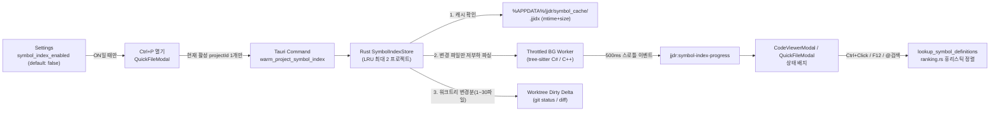

# 코드뷰어 심볼 점프(Symbol Jump) 구현 계획서

- **작성일**: 2026-11-28
- **대상 버전**: v0.5.2 (예정)
- **타깃 규모**: 대형 엔터프라이즈 리포지토리 — **C# 약 20,000 파일**, **C++ 약 10,000 파일** (멀티 워크트리 환경 포함)
- **핵심 동작 원칙**:
  1. **Settings Opt-in (기본값 OFF)**: `symbol_index_enabled = false` 기본. 꺼져 있을 때는 워커 0, 추가 RAM 0 MB, 디스크 I/O 0.
  2. **Lazy Per-Project 시동**: Settings가 ON일 때만, 사용자가 **`Ctrl+P` (`QuickFileModal`)를 열면 현재 활성 프로젝트 1개에 대해서만** 백그라운드 심볼 인덱싱 시동.
  3. **UI 무중단 저부하**: 대용량 파싱은 Rust 백그라운드 워커가 배치 단위 양보(yield)로 천천히 처리하며, UI는 가상화·메모이제이션·Zero-Blur 원칙 유지.

---

## 1. 아키텍처 개요

### 1.1 왜 LSP(`clangd` / `Roslyn`)가 아니라 Rust `tree-sitter`인가?
| 항목 | LSP (`clangd` / `OmniSharp`) | Rust 네이티브 `tree-sitter` (채택) |
|---|---|---|
| C# 20k + C++ 10k RAM | 프로젝트당 1~4 GB+ (워크트리마다 폭증) | **C# 20k ≈ 25~40 MB / C++ 10k ≈ 15~25 MB** |
| 빌드 의존성 | `compile_commands.json`, `.sln` restore 필수 | **불필요 (소스 파일만으로 즉시 동작)** |
| 멀티 워크트리 (5~20개) | 워크트리별 중복 분석 / 락 충돌 | **Shared Base 1회 + Worktree Dirty Delta만 파싱** |
| 외부 설치 요구 | 별도 언어 서버 설치 필요 | **단일 바이너리 내장 (설치 0)** |
| 정확도 | 100% 타입 기반 | **AST 정의 추출 + 스코프/`#include`/`using` 랭킹 (체감 85~92%)** |

### 1.2 전체 데이터 흐름


---

## 2. C# 20,000 / C++ 10,000 규모 성능·메모리 설계

### 2.1 메모리 압축 전략 (String Interning + Compact Struct)
심볼마다 `String`을 할당하면 50만 심볼 기준 150~300 MB까지 불어납니다. 이를 방지하기 위해 **문자열 인터닝 + 고정 크기 구조체**를 사용합니다.

```rust
// 20 bytes per symbol
pub struct CompactSymbol {
    pub name_id: u32,   // interned symbol name
    pub file_id: u32,   // interned relative path
    pub scope_id: u32,  // interned enclosing class/struct/namespace (0 = global)
    pub line: u32,      // 1-based line number
    pub col: u16,       // 0-based column
    pub kind: u8,       // Class, Struct, Interface, Enum, Method, Function, Property, Macro, ...
    pub flags: u8,      // bit0: is_definition (vs declaration), bit1: is_partial
}
```

| 프로젝트 규모 | 예상 심볼 수 | RAM 사용량 (예상) | 디스크 캐시 크기 | 콜드 인덱싱 (최초 1회) | 웜 리로드 (재시작 후) |
|---|---|---|---|---|---|
| C# 20,000 파일 | ~400k ~ 550k | **25 ~ 40 MB** | ~12 ~ 20 MB | ~15 ~ 35초 (BG) | **~1 ~ 2초** |
| C++ 10,000 파일 | ~150k ~ 250k | **15 ~ 25 MB** | ~6 ~ 12 MB | ~8 ~ 20초 (BG) | **~0.5 ~ 1초** |
| Settings OFF | 0 | **0 MB** | 0 | 0 | 0 |

### 2.2 6중 안전장치
1. **엄격한 RAM LRU (최대 2개 프로젝트)**: C# 20k + C++ 10k 동시 상주 시에도 합산 ~45~65 MB로 상한 고정. 3번째 프로젝트 시동 시 가장 오래된 프로젝트는 RAM에서 해제(Evict)하고 디스크 캐시만 보존.
2. **Settings OFF 즉시 정리**: Settings에서 토글을 OFF로 끄면 진행 중인 워커에 `AtomicBool` 취소 신호 전송 + RAM 인덱스 즉시 `clear()`.
3. **Shared Base + Worktree Delta**: 기존 `FileIndexStore`와 동일하게 메인 리포 Base 1개만 전체 인덱싱하고, 형제 워크트리는 `git status --porcelain` + `git diff --name-only HEAD`로 바뀐 파일만 즉석 파싱하여 오버레이.
4. **자동생성·초대형 파일 필터**:
   - `git ls-files` 기반 스캔(`bin/`, `obj/`, `build/`, `.vs/`, `node_modules/` 자동 제외)
   - 파일 크기 **512 KB 초과 스킵**
   - 자동생성 파일 패턴 스킵: `*.g.cs`, `*.g.i.cs`, `*.Designer.cs`, `*.pb.h`, `*.pb.cc`, `*.generated.h`, `*.generated.cpp`, `*.min.js`
5. **Windows Defender / I/O 스파이크 방지**:
   - 동시 파싱 워커 **최대 2 스레드** 제한 (`spawn_blocking` 전용 풀 또는 순차 배치).
   - 배치 단위(32 파일) 파싱 후 `6ms` 양보(`std::thread::sleep`)하여 디스크 I/O·CPU 점유율을 부드럽게 분산.
   - 진행률 이벤트(`jjdr:symbol-index-progress`)는 최소 `500ms` 간격으로만 emit.
6. **증분 영속 디스크 캐시 (`%APPDATA%/jjdr/symbol_cache/<repo_hash>.jjidx`)**:
   - 파일별 `(relative_path, mtime_secs, file_size)` 핑거프린트 저장.
   - 재시작 후 `Ctrl+P`를 열면 메타데이터(`stat`)만 비교해 변경 없는 99.9% 파일은 읽기·파싱 스킵.
   - 스키마 버전 헤더(`JJIDX\x01`) 검증으로 구버전·손상 캐시는 안전하게 무시 후 재생성.

---

## 3. C# / C++ 심볼 추출 & 동명이인 랭킹 설계

### 3.1 `tree-sitter` 추출 대상
- **C# (`tree-sitter-c-sharp`)**:
  - `namespace_declaration`, `file_scoped_namespace_declaration`
  - `class_declaration`, `struct_declaration`, `interface_declaration`, `record_declaration`, `enum_declaration`
  - `method_declaration`, `constructor_declaration`, `property_declaration`, `delegate_declaration`, `event_declaration`
  - `partial` 키워드 플래그 기록 (`flags |= IS_PARTIAL`)
  - 파일 상단 `using Foo.Bar;` 목록 추출(랭킹 가산용)
- **C / C++ (`tree-sitter-cpp`)**:
  - `namespace_definition`, `class_specifier`, `struct_specifier`, `enum_specifier`, `union_specifier`
  - `function_definition` (`is_definition = true`, `Foo::Bar(...)`의 경우 `scope = Foo`, `name = Bar`로 분리)
  - 헤더 내 함수 `declaration` (`is_definition = false`)
  - `type_definition` (`typedef`), `alias_declaration` (`using X = ...`), `preproc_def` / `preproc_function_def` (`#define`)
  - 파일 내 `#include "..."` 경로 목록 추출(랭킹 + 직접 파일 점프용)

### 3.2 다중 정의 랭킹 휴리스틱 (`ranking.rs`)
`Update()`, `Init()`, `Dispose()`처럼 동명이인이 많은 심볼을 클릭했을 때 가장 확률 높은 후보를 최상단에 올립니다.
1. **한정자(Qualifier) 일치 (+100)**: 클릭 위치 앞이 `Inventory::AddItem`(C++) 또는 `Inventory.AddItem`(C#)이면 `scope == "Inventory"` 최우선.
2. **`#include` / `using` 의존성 일치 (+60)**: 현재 파일의 `#include` 대상 파일이나 `using Namespace;`와 일치하는 심볼 가산.
3. **근접 파일 가산 (+40)**: 동일 파일 > `.h`↔`.cpp` 동일 스템 페어 > 동일 디렉터리 > 상위 공통 경로 길이.
4. **정의(Definition) 우선 (+20)**: C++ `.cpp` 구현부를 `.h` 선언부보다 우선 (단, 현재 커서가 이미 정의 위에 있으면 반대쪽 선언을 상단 제안).
5. **결과 처리 UX**:
   - 후보 1개(또는 압도적 단일 파일 일치): **즉시 해당 파일·줄로 점프**.
   - 후보 2개 이상: **`SymbolPickerPopover`** 표시 (파일경로, 줄번호, 심볼 종류 배지, 스코프, 1줄 코드 미리보기 + `↑/↓/Enter/Esc`).

---

## 4. 파일 구조 및 모듈 분리 계획 (900줄 제한 엄수)

기존 `CodeViewerModal.tsx`(583줄)과 `QuickFileModal.tsx`(563줄)이 비대해지지 않도록 모든 신규 UI/로직을 작은 전용 파일로 분리합니다.

### 4.1 Rust 백엔드 (`src-tauri/`)
| 파일 | 역할 | 예상 줄 수 |
|---|---|---|
| `src-tauri/Cargo.toml` | `tree-sitter`, `tree-sitter-c-sharp`, `tree-sitter-cpp` (옵션: `ts`/`rust`) 의존성 추가 | +10 |
| `src-tauri/src/symbols/mod.rs` | 모듈 공개 인터페이스 | ~30 |
| `src-tauri/src/symbols/types.rs` | `CompactSymbol`, `SymbolKind`, `SymbolMatch`, `SymbolIndexStatus`, `OutlineSymbol` | ~180 |
| `src-tauri/src/symbols/interner.rs` | 문자열 인터너 (name/file/scope 풀 + 역조회) | ~120 |
| `src-tauri/src/symbols/parser.rs` | `tree-sitter` C#/C++ AST 추출기 + `#include`/`using` 파서 + 단일 파일 Outline | ~380 |
| `src-tauri/src/symbols/cache.rs` | 컴팩트 바이너리 캐시 직렬화/역직렬화 (`mtime`/`size` 증분 검증) | ~240 |
| `src-tauri/src/symbols/ranking.rs` | 한정자·include·using·근접도·정의우선 스코어링 | ~220 |
| `src-tauri/src/symbols/store.rs` | `SymbolIndexStore` (LRU 2개, Base+Worktree Delta, 저부하 BG 워커, 취소/이벤트) | ~420 |
| `src-tauri/src/commands/symbols.rs` | Tauri IPC 커맨드 7종 (`warm`, `status`, `lookup`, `search`, `outline`, `resolve_include`, `clear_cache`) | ~220 |
| `src-tauri/src/store/projects.rs` | `AppSettings.symbol_index_enabled: bool` (default `false`) 추가 | +8 |
| `src-tauri/src/commands/files.rs` | `open_in_vscode`에 `line: Option<u32>` 지원 (`code -g path:line`) | +15 |
| `src-tauri/src/lib.rs` | `AppState.symbol_index: Arc<SymbolIndexStore>` 등록 및 커맨드 연결 | +20 |

### 4.2 프론트엔드 (`src/`)
| 파일 | 역할 | 예상 줄 수 |
|---|---|---|
| `src/types/domain.ts` | `AppSettings.symbol_index_enabled`, 심볼 DTO 타입 정의 | +55 |
| `src/services/tauriBridge.ts` | 심볼 커맨드 invoke 래퍼 + `openInVsCode(path, line?)` | +65 |
| `src/store/useUiStore.ts` | `CodeViewerTarget`에 `projectId?`, `repoPath?`, `initialLine?`, `initialCol?` 추가 | +10 |
| `src/utils/codeHighlighter.ts` | `csharp` 언어 분리 (`.cs` 전용 키워드/라벨) | +35 |
| `src/utils/symbolClickTarget.ts` | 클릭한 줄/컬럼에서 식별자 + 앞쪽 한정자(`Foo::Bar`/`Foo.Bar`) + `#include "..."` 추출 | ~180 |
| `src/hooks/useCodeNavigationHistory.ts` | 파일/줄 점프 히스토리 스택 (`Alt+←`, `Alt+→`, 마우스 4/5버튼) | ~110 |
| `src/components/modals/codeViewer/SymbolPickerPopover.tsx` | 다중 정의 선택 팝오버 (키보드 네비게이션, 스코프/종류 배지, Zero-Blur) | ~210 |
| `src/components/modals/codeViewer/CodeOutlinePopover.tsx` | `Ctrl+Shift+O` 현재 파일 심볼 아웃라인 팝오버 | ~180 |
| `src/components/modals/codeViewer/SymbolIndexBadge.tsx` | 인덱싱 진행률/준비 상태 헤더 배지 (`jjdr:symbol-index-progress` 구독) | ~110 |
| `src/components/modals/settings/SymbolIndexSettingsSection.tsx` | Settings 내 심볼 인덱싱 ON/OFF 스위치 + RAM/디스크 사용량 + 캐시 삭제 | ~190 |
| `src/components/modals/settings/GeneralSettingsTab.tsx` | `SymbolIndexSettingsSection` 마운트 | +20 |
| `src/components/modals/SettingsModal.tsx` | 토글 OFF 시 `clearSymbolIndexCache(false)` 즉시 호출 연동 | +20 |
| `src/components/modals/QuickFileModal.tsx` | 열릴 때 `symbol_index_enabled`면 활성 프로젝트만 `warmProjectSymbolIndex` 트리거 + `@심볼` 모드 + `projectId`/`repoPath` 전달 | +90 |
| `src/components/modals/CodeViewerModal.tsx` | `initialLine` 점프/플래시, `Ctrl+Click`/`F12` 핸들러, 히스토리 버튼, Outline/Picker 연결 | +140 (총 ~720줄, 900줄 미만 유지) |

---

## 5. 단계별 실행 계획 (Phased Delivery)

### Phase 1 — 제로-RAM 즉시 체감 UX & 네비게이션 기반
- `open_in_vscode` `code -g "<path>:<line>"` 지원 (현재 줄/활성 줄로 VS Code 열기).
- `CodeViewerTarget`에 `projectId`, `repoPath`, `initialLine`, `initialCol` 추가 + 열릴 때 자동 스크롤 및 1.2초 도착 줄 하이라이트.
- `useCodeNavigationHistory.ts` (`Alt+←` / `Alt+→`, 헤더 뒤로/앞으로 버튼).
- `codeHighlighter.ts` C# 전용 구문 강조 분리.
- `symbolClickTarget.ts` 구현 + `#include "..."` `Ctrl+Click` 직접 파일 열기 (인덱스 OFF여도 즉시 동작).

### Phase 2 — Rust `tree-sitter` 심볼 엔진 & 증분 디스크 캐시
- `src-tauri/Cargo.toml`에 `tree-sitter` + `tree-sitter-c-sharp` + `tree-sitter-cpp` 추가 및 Windows MSVC 컴파일 검증.
- `src-tauri/src/symbols/` 전체 모듈(`types`, `interner`, `parser`, `cache`, `ranking`, `store`) 구현.
- `src-tauri/src/commands/symbols.rs` 7개 커맨드 구현 및 `lib.rs` 등록.
- `AppSettings.symbol_index_enabled` (default `false`) Rust/TS 연동.

### Phase 3 — Settings Opt-in + `Ctrl+P` Lazy 시동 + `CodeViewerModal` 심볼 점프
- `SymbolIndexSettingsSection.tsx` 구현 및 `GeneralSettingsTab` / `SettingsModal` 연결 (OFF 전환 시 즉시 워커 중단 & RAM 해제).
- `QuickFileModal.tsx`:
  - 모달 오픈 시 `settings.symbol_index_enabled === true`인 경우에만 현재 활성 프로젝트 1개에 대해 `warmProjectSymbolIndex` 호출.
  - `@<검색어>` 입력 시 워크스페이스 심볼 검색 결과 표시 및 해당 파일+줄로 즉시 오픈.
- `CodeViewerModal.tsx`:
  - `Ctrl` 키 홀드 시 식별자 밑줄 표시(호버 피드백) + `Ctrl+Click` / `F12` Go to Definition.
  - `SymbolPickerPopover.tsx` 다중 후보 선택 + `CodeOutlinePopover.tsx` (`Ctrl+Shift+O`) + `SymbolIndexBadge.tsx`.

### Phase 4 — 대용량 검증, 성능 체크, 문서화
- **Rust 단위·벤치마크 테스트**:
  - C#(`partial class`, `record`, `namespace`, `property`, `method`) / C++(`class`, `namespace`, `Foo::Bar` 구현/선언, `#define`, `using`, `struct`) 파서 테스트.
  - 합성 **20,000 C# 파일 + 10,000 C++ 파일** 스트레스 테스트(파싱 시간, 피크 RAM, 증분 캐시 리로드 시간 측정).
  - LRU 2프로젝트 Eviction & 취소 토큰 즉시 중단 테스트.
- **프론트엔드 테스트 (Vitest)**:
  - `symbolClickTarget.test.ts` (C++ `::`, `->`, `.`, `#include`, C# `.`, 제네릭 `<T>` 경계 케이스).
  - `useCodeNavigationHistory.test.ts`, Settings 기본값 `false` 검증.
- **성능·규칙 최종 점검**: Zero-Blur 확인, 전 파일 900줄 이하 확인, `npm run test` & `npm run build` & `cargo test` 통과.
- 결과 기록(`docs/test_results_2026-11-28_symbol_jump.txt`) 및 `APP_MAP.md` 업데이트.

---

## 6. 형님 확정 사항 (2026-11-28)

1. **지원 언어 범위**: **C# + C++ + TypeScript/JS + Rust** 4종 지원 (`tree-sitter-c-sharp`, `tree-sitter-cpp`, `tree-sitter-typescript`, `tree-sitter-rust`).
2. **검색 역할 분리 (VS Code 멘탈 모델)**:
   - `Ctrl+P` (`QuickFileModal`): **파일 검색 전용** (`@심볼` 모드 제외). 단, Settings에서 심볼 인덱싱 ON일 때 열리면 현재 활성 프로젝트 1개에 대해 백그라운드 심볼 인덱싱 시동.
   - **`Ctrl+Shift+F` (`WorkspaceSearchModal`)**: `Ctrl+P`와 **동일 최상위 레벨의 전역 모달**로 프로젝트/워크트리 전체 단어·정규식(`.*`/`Aa`/`ab`) 고속 찾기 (결과 선택 시 `CodeViewerModal` 해당 줄로 바로 점프).
   - `CodeViewerModal` 내 **`Ctrl+Shift+O`**: **해당 파일 내 심볼 검색 (Outline)** (인덱스 OFF여도 즉석 파싱 <2ms 지원).
3. **인덱스 OFF 시에도 제로-코스트 미니 기능 기본 제공**: `Ctrl+Shift+O` 아웃라인, `Ctrl+Shift+F` 전체 찾기(Regex), `#include "..."` 직접 점프, `Alt+←/→` 히스토리, `VS Code -g path:line` 열기.
