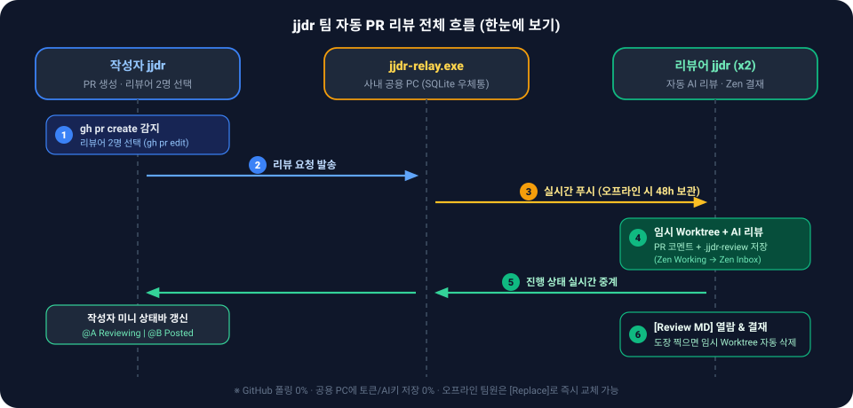

# jjdr 팀 자동 PR 리뷰 가이드 (Team PR Auto-Review Handbook)

> **대상**: 사내 GHE / GitHub 환경에서 `jjdr`를 쓰는 팀원 누구나 (3분 세팅)  
> **구조**: `작성자 jjdr` ↔ `jjdr-relay.exe (사내 공용 PC 1대)` ↔ `리뷰어 jjdr` (GitHub 폴링 **0%**, GHE 토큰 공용 PC 저장 **0%**)



---

## 1. 최초 1회 세팅

### ① 공용 PC 서버 (`jjdr-relay.exe`) 실행 *(팀에서 1대만)*
자세한 방화벽·작업 스케줄러 등록 방법은 [relay/README.md](../relay/README.md)를 참고하세요.
```powershell
$env:JJDR_RELAY_BIND = "0.0.0.0:8787"
$env:JJDR_RELAY_TEAM_KEY = "우리팀-비밀키"
.\jjdr-relay.exe
```

### ② 내 PC `jjdr` 설정 (`Settings` → `Team Orchestration`)
1. **Enable Team Orchestration** 스위치 **ON**
2. **Relay URL** (`http://<공용PC-IP>:8787`) & **Team Key** 입력
3. **Bypass Corporate Proxy (`no_proxy`)**: 사내 망이면 **ON** 유지
4. **`[Test Connection]`** 클릭 → 초록색 `Connected` 확인
5. **GitHub ID**: **`[Auto-detect via gh]`** 클릭 *(사내 GHE `GH_HOST` 자동 인식)*
6. **리뷰어용 AI/상한 설정**:
   - **1순위 AI / 모델** + **Fallback AI / 모델** *(Rate Limit / 429 발생 시 1회 자동 전환)*
   - **동시 상한**: 글로벌(기본 2) / 프로젝트별(기본 1) — 초과 시 로컬 FIFO 큐 대기
   - **Pre-defined 프롬프트**: 기본 프롬프트 또는 리뷰 스킬(예: `$pr-review`) 지정
7. **Save** → 상단 상태가 `Online`으로 바뀌면 팀 디렉토리에 자동 등록 완료!

---

## 2. 작성자: 리뷰 요청하기 (2가지 방법)

### A. 자동 감지 (Track B)
1. 작업하던 Worktree 터미널에서 **`gh pr create`**로 PR을 생성합니다.
2. `jjdr`가 단발 `gh pr view` 1회로 **내 PR · OPEN · Non-Draft · 최근 15분 이내**를 검증한 뒤 하단 중앙에 퀵 바를 띄웁니다:
   - `PR #412 created` → **`[Select 2 Reviewers]`** 클릭
3. 모달에서 리뷰어 **최대 2명** 선택 후 **`[Send Request]`** 클릭!
   - `Also assign on GitHub (gh pr edit)`가 켜져 있으면 GHE PR 리뷰어 등록까지 한 번에 끝납니다.
   - GHE 알림 없이 Relay 테스트만 하려면 해당 체크를 끄고 발송하세요.

### B. 수동 원클릭 요청 (Draft→Ready · 기존 PR · 재Push)
- **Radar 뷰 (`Ctrl+1`)**: PR이 연결된 카드에 마우스를 올려 **`👥`** 아이콘 클릭
- **Zen Inbox 뷰 (`Ctrl+3`)**: 카드 우측 **`[Request Review]`** 버튼 클릭

### 작성자 실시간 미니 상태바
발송한 PR 카드 하단에 리뷰어별 상태가 실시간 표시됩니다:
- `Queued` / `Starting` / `Reviewing` / `Posted` / `Offline` / `Rejected` / `AI Quota`
- `Offline` · `Rejected` · `Failed` · `Expired` 슬롯에는 **`[Replace]`**(1명 즉시 교체) 및 **`[×]`**(취소) 버튼이 제공됩니다.

---

## 3. 리뷰어: 자동 수행 → Markdown 열람 → 자동 정리

1. 리뷰 요청을 받으면 `jjdr`가 로컬 Reject 규칙(Paused, Draft/Closed, 제외 라벨/브랜치, 프로젝트 OFF 등)을 검사합니다.
2. 통과 시 **임시 리뷰 전용 Worktree**(`jjdr-rev-pr<N>-<id>`, `skip_bootstrap`, `detached HEAD`)를 만들고 Fresh AI 세션을 띄웁니다.
3. **Zen Working (`Time to chill` 영역)**에 `AUTO-REVIEW` 배지 카드로 표시되며, 클릭 시 AI 진행 화면을 바로 볼 수 있습니다.
4. 리뷰 완료(PR 코멘트 + `.jjdr-review/pr-<N>.md` 저장) 후 **Zen Inbox**로 올라오면:
   - **`[Review MD]`** 버튼 → 내장 `MarkdownViewerModal`에서 리뷰 전문 열람
   - **결재 도장(`Ctrl+Enter`)** → 임시 Worktree 백그라운드 자동 삭제 + 대기열 다음 PR 즉시 시작

---

## 4. 장애·예외 대응 요약
- **리뷰 중 PC 재부팅**: 재실행 8초 후 `auto_review_jobs.json` + Relay `sync-active` + `herdr-core` 3자 대조로 자동 복구 (`claude`/`agy`는 `--continue`, `gemini`/`codex`는 Fresh 재시작).
- **1순위 AI 한도 초과(429)**: 자동 감지 후 2순위 Fallback AI로 1회 자동 전환.
- **Relay 일시 다운**: 로컬 `relay_outbox.json`에 보관했다가 재연결 즉시 자동 전송 (`jjdr` 기존 기능은 100% 정상 동작).
- **오프라인 리뷰어**: Relay가 48시간 보관 후 재접속 시 자동 배달(At-Least-Once + `device_id` 다중 기기 중복 차단).
