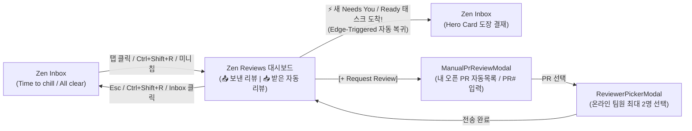

# Zen 팀 리뷰 대시보드 (`Reviews` 탭) 구현 계획서

- **작성일**: 2026-11-28
- **대상 버전**: v0.5.4 (예정)
- **확정 방향 (형님 결정)**:
  1. **A안 채택**: Zen 상단 탭을 `[ Inbox | Dispatch | Reviews ]` 3탭으로 확장 *(팀 모드 ON일 때만 노출, OFF면 기존 2탭 유지 & 오버헤드 0)*.
  2. **자동 Inbox 복귀 (핵심 규칙)**: 리뷰 대시보드(`Reviews` 탭)를 보고 있을 때 **승인할 태스크(유저 승인 `Needs You`, 작업 완료 `Ready`, 받은 자동 리뷰 완료 등)가 새로 생기면 즉시 도장 찍는 `Inbox`로 자동 전환**.
  3. **초고속 왕복**: `Ctrl+Shift+R` 전역 토글 + `Esc` 즉시 `Inbox` 복귀 + `Time to chill` / `All clear` 초슬림 1줄 요약 칩.
  4. **수동 리뷰 요청 접근성 극대화**: `[+ Request Review]` 버튼 → 프로젝트별 `gh pr list --author @me --state open` 자동 조회 (또는 PR 번호/URL 직접 입력) → 즉시 온라인 리뷰어 선택 & Relay 전송.

---

## 1. 핵심 UX 및 상태 전이 설계

### 1.1 자동 Inbox 복귀(Edge-Triggered) 안전 설계
단순히 `inboxCount > 0` 조건으로 무조건 전환하면, 이미 결재 대기 카드가 1장 있는 상태에서 사용자가 **일부러** `Reviews` 탭을 눌렀을 때 0ms만에 튕겨 나오는 버그가 발생합니다. 이를 원천 차단하기 위해 순수 상태 판정 함수(`shouldAutoReturnFromReviews`)로 설계합니다.

1. `zenModeTab === "reviews"`에 진입하는 순간, 현재 존재하던 대기 카드 키 집합(`enteredInboxKeysRef: Set<string>`)을 스냅샷으로 저장합니다.
2. `Reviews` 탭을 보고 있는 동안 `visibleNeedsYou` 또는 `visibleReady`에 **스냅샷에 없던 새 카드 키가 1개라도 등장**하면(또는 `enteredInboxKeysRef`가 비어 있던 `Time to chill` 상태에서 어떤 카드든 생기면):
   - 즉시 `setZenModeTab("inbox")` 호출 (도장 찍는 Hero Card + 우측 터미널 자동 연결).
   - 만약 사용자가 `ManualPrReviewModal` 또는 `ReviewerPickerModal`을 열어 조작 중인 경우에도 모달을 닫지 않고 유지한 채 뒤쪽 탭만 `inbox`로 전환해두어, 입력 유실 없이 모달을 닫는 즉시 도장 화면이 대기하도록 처리합니다.
   - 짧은 비방해 토스트(`"새 승인/완료 태스크 도착 — Inbox로 전환했습니다"`, 1.8초) 표시.
3. 사용자가 `Reviews`에 머무는 동안 이미 있던 카드가 사라졌다가 나중에 다시 새 카드가 생기면 `enteredInboxKeysRef`도 교집합으로 동기화하여 재등장 시에도 놓치지 않고 정확히 반응합니다.

---

## 2. 대시보드 화면 구성 (Zero-Blur, 2컬럼 한눈에 스캔)

### 2.1 상단 1줄 컨트롤 바 (`ZenReviewsHeader.tsx`)
- **좌측**:
  - **`[+ Request Review]`** 강조 알약 버튼 → `ManualPrReviewModal` 오픈
  - 새로고침 버튼 (`listAuthoredTeamReviews` + `listAutoReviewJobs` 즉시 동기화)
- **우측**:
  - **내 수신 상태 원클릭 토글**: `Receiving ON` (초록) ↔ `Paused` (노랑) — Settings에 들어가지 않고 바쁠 때 즉시 토글(`saveSettings` 호출)
  - **온라인 팀원 미니 스트립**: Relay 연결 상태 점 + `Online N` + 피어 핸들 칩(`@alice ●`, `@bob ⏸`)

### 2.2 좌측 컬럼 — 📤 내가 요청한 리뷰 (`ZenOutgoingReviewsColumn.tsx`)
- 데이터 소스: `useAppStore.authoredReviews` (Worktree를 삭제했어도 PR 단위로 계속 추적)
- 정렬: 진행 중(`reviewing`/`queued`/`dispatched`/`delivered`) → 조치 필요(`rejected`/`offline`/`expired`) → 완료(`completed`) 순, 최신 우선
- 각 PR 카드:
  - 프로젝트 컬러 점 + 프로젝트명 + `PR #번호` + PR 제목 + `head → base` 브랜치
  - 리뷰어별 실시간 칩 (`@id ● Reviewing` / `✓ Posted` / `✕ Rejected` / `⚠ Offline (Interrupted)` / `Queued`)
  - 원클릭 액션:
    - **`[GitHub]`**: PR 웹페이지 열기 (`openExternalUrl`)
    - **`[Replace]`**: 거절·오프라인·만료 슬롯을 다른 온라인 팀원으로 즉시 교체 (`ReviewerPickerModal` 재사용)
    - **`[Cancel]`**: 진행 중인 특정 리뷰어 요청 취소 (`cancelAuthoredTeamReview`)
    - **`[+ Add]`**: 활성 리뷰어가 2명 미만일 때 추가 리뷰어 1명 더 배정

### 2.3 우측 컬럼 — 📥 나에게 온 자동 리뷰 (`ZenIncomingReviewsColumn.tsx`)
- 데이터 소스: `useAppStore.autoReviewJobs`
- 정렬: `ready_for_ack` (최상단) → `reviewing` / `creating_wt` → `queued` → `failed`
- 각 작업 카드:
  - 상태 배지 (`Ready for Ack` / `Reviewing` / `Queued #N` / `Failed`), 프로젝트명, `PR #번호`, 작성자(`@author`), 에이전트/모델 배지, 경과 시간
  - 원클릭 액션:
    - `reviewing`: **`[Peek]`** (우측 터미널 드로어에 해당 리뷰어 AI 실시간 로그 즉시 연결!) + **`[Cancel]`**
    - `ready_for_ack`: **`[Review MD]`** (내장 `MarkdownViewerModal`로 리뷰 리포트 즉시 열람) + **`[Ack & Cleanup]`** (결재 완료 + 임시 Worktree 정리 + 다음 큐 자동 실행)
    - `queued` / `failed`: **`[Cancel]`** / **`[Dismiss]`**

### 2.4 원클릭 수동 PR 리뷰 요청 모달 (`ManualPrReviewModal.tsx`)
- **Step 1**: 프로젝트 드랍다운 선택 (등록 프로젝트 중 선택, 현재 포커스 프로젝트 자동 기본값)
- **Step 2 (자동 로드 + 직접 입력 동시 지원)**:
  - 선택된 프로젝트에 대해 Rust 커맨드 **`list_my_open_prs(project_id)`** 호출 (`gh pr list --author @me --state open --limit 20 --json ...`, 사내 GHE `GH_HOST` 자동 추출 + **프로젝트별 20초 메모리 캐시** + 10초 타임아웃 적용)
  - 내가 열어둔 오픈 PR 리스트(번호, 제목, 브랜치, Draft 여부, 갱신 시각)를 클릭 한 번으로 선택!
  - 또는 상단 입력칸에 **PR 번호(`3`) 또는 PR URL**을 직접 입력 후 `Enter`로 즉시 조회 (`inspectPrForReviewRequest(manual: true)`)
- **Step 3**: 검증된 `PrReviewCandidate`를 기존 **`ReviewerPickerModal`**로 바로 넘겨 온라인 팀원 최대 2명 선택 후 발송!

### 2.5 `Time to chill` / `All clear` 미니 요약 칩
- `ZenEmptyBriefing` (기본 카드형) 및 `ZenScenicEmptyHud` (4종 도트/사진 시닉 HUD) 모두에서:
  - 팀 모드 ON이고 활성 리뷰(보낸 리뷰 진행 중/조치 필요 또는 받은 리뷰 존재)가 있거나 온라인 팀원이 있을 때, 배경을 가리지 않는 **초슬림 1줄 칩** 표시:
    `Team Reviews · 보낸 2 · 받은 1 → (Ctrl+Shift+R)`
  - 클릭 시 즉시 `Zen Reviews` 탭으로 이동.

---

## 3. 파일 구조 및 모듈 분리 계획 (900줄 제한 엄수)

현재 `ZenModeView.tsx`가 **867줄**로 900줄 상한에 근접해 있으므로, 상단 탭 바를 먼저 `ZenModeTopBar.tsx`로 분리하여 모든 파일을 **750줄 이하**로 유지합니다.

### 3.1 Backend (`src-tauri/`)
| 파일 | 변경 내용 | 예상 증감 |
|---|---|---|
| `src-tauri/src/team/author.rs` | `MyOpenPrItem` 구조체 및 `list_my_open_prs_via_gh(repo_path, repo_url)` 구현 (GHE `GH_HOST` 지원, 타임아웃/에러 안전 처리) | +75줄 |
| `src-tauri/src/commands/team.rs` | `list_my_open_prs(project_id: String)` 커맨드 추가 | +25줄 |
| `src-tauri/src/lib.rs` | `commands::team::list_my_open_prs` 핸들러 등록 | +1줄 |

### 3.2 Frontend (`src/`)
| 파일 | 역할 | 예상 줄 수 |
|---|---|---|
| `src/types/domain.ts` | `MyOpenPrItem` 인터페이스 추가 | +12줄 |
| `src/services/tauriBridge.ts` | `listMyOpenPrs(projectId)` 래퍼 추가 | +8줄 |
| `src/store/useUiStore.ts` | `ZenModeTab = "inbox" \| "dispatch" \| "reviews"`, `openZenReviews()`, `manualReviewModalOpen` 상태 추가 | +20줄 |
| `src/utils/modalGuard.ts` | `manualReviewModalOpen` 블로킹 가드 추가 (+ `modalGuard.test.ts`) | +4줄 |
| `src/utils/zenReviews.ts` | 순수 함수: `shouldAutoReturnFromReviews`(Edge-Triggered 자동 복귀 판정), `summarizeTeamReviews`(배지/미니칩 요약 카운트), `sortOutgoingReviews`, `sortIncomingAutoReviews`, `parsePrNumberOrUrl` (+ `zenReviews.test.ts`) | ~180줄 |
| `src/components/zen/ZenModeTopBar.tsx` | `ZenModeView.tsx`에서 상단 바 분리 + 3번째 `Reviews` 탭(팀 모드 ON 전용, 활성/주의 배지 표시) | ~185줄 |
| `src/components/zen/ZenReviewsView.tsx` | Zen `Reviews` 탭 메인 컨테이너 (상단 컨트롤 바 + 2컬럼 그리드 + 새로고침 + 수신 Pause 토글 + `ManualPrReviewModal` 마운트) | ~260줄 |
| `src/components/zen/ZenOutgoingReviewsColumn.tsx` | 좌측 📤 내가 요청한 리뷰 리스트 & `GitHub`/`Replace`/`Cancel`/`+Add` 액션 | ~220줄 |
| `src/components/zen/ZenIncomingReviewsColumn.tsx` | 우측 📥 나에게 온 자동 리뷰 리스트 & `Peek`/`Review MD`/`Ack & Cleanup`/`Cancel` 액션 | ~210줄 |
| `src/components/team/ManualPrReviewModal.tsx` | 프로젝트 선택 + `listMyOpenPrs` 자동 목록 + PR#/URL 직접 입력 → `ReviewerPickerModal` 연결 모달 (Zero-Blur) | ~240줄 |
| `src/components/zen/ZenModeView.tsx` | `ZenModeTopBar` 사용으로 867줄 → ~740줄 축소 + `Reviews` 탭 렌더링 + **새 승인/완료 태스크 도착 시 자동 `Inbox` 복귀 `useEffect`** 연결 | -120줄 (총 ~745줄) |
| `src/components/zen/ZenEmptyBriefing.tsx` & `ZenScenicEmptyHud.tsx` | 팀 모드 ON 시 초슬림 1줄 `Team Reviews` 진입 칩 추가 | +35줄씩 |
| `src/hooks/useGlobalShortcuts.ts` | 전역 `Ctrl+Shift+R` (`Reviews` 탭 토글) 및 `Esc` (`Reviews` → `Inbox` 즉시 복귀) 추가 | +25줄 |
| `src/hooks/useXtermSession.ts` | `isReservedGlobalShortcut`에 `Ctrl+Shift+R` 등록 (터미널 포커스 중에도 즉시 동작) | +3줄 |

---

## 4. 단계별 실행 및 검증 계획

1. **Phase 1 — Rust `list_my_open_prs` + 순수 로직 & 스토어 기반**:
   - `author.rs` / `commands/team.rs` / `lib.rs`에 `list_my_open_prs` 추가 및 Rust 단위 테스트.
   - `useUiStore.ts`, `modalGuard.ts`, `zenReviews.ts` (+ `zenReviews.test.ts` — Edge-Triggered 자동 복귀, 기존 대기 카드 유지 시 미튕김, 새 카드 도착 시 즉시 복귀, PR URL/번호 파싱 검증).
2. **Phase 2 — `ZenModeTopBar` 분리 + `ZenReviewsView` 2컬럼 대시보드 + `ManualPrReviewModal`**:
   - 900줄 제한 준수하며 모든 UI 컴포넌트 Zero-Blur + `React.memo` 구현.
   - `ZenModeView.tsx`에 자동 `Inbox` 복귀 훅, `Peek Terminal`, `Review MD` 연동.
   - `ZenEmptyBriefing` / `ZenScenicEmptyHud` 미니 칩 + 전역 `Ctrl+Shift+R` & `Esc` 단축키 연결.
3. **Phase 3 — 성능·회귀 검증 및 문서화**:
   - `cargo test --offline`, `cargo check --offline`, `npm run test`, `npm run build` 전체 통과 확인.
   - 전 파일 900줄 이하 & Zero-Blur 체크, 팀 모드 OFF 시 오버헤드 0% 검증.
   - `docs/test_results_2026-11-28_zen_reviews.txt` 기록 및 `APP_MAP.md` 업데이트.

---

## 5. 추가 아이디어 (함께 넣으면 좋을 소소한 디테일)

1. **`Reviews` 탭 진입 시 1회 자동 동기화**: 탭을 열 때 `listAuthoredTeamReviews()` + `listAutoReviewJobs()`를 백그라운드로 1회 갱신해 최신 상태를 보장 (평소에는 WS 실시간 이벤트만 받으므로 불필요한 폴링 0).
2. **상단 `Reviews` 탭 배지 색상 구분**:
   - 조치 필요한 항목(받은 `Ready for Ack`, 보낸 리뷰 `Rejected`/`Offline`)이 있으면 **노랑/코랄 배지**, 단순 진행 중(`Reviewing`/`Queued`)이면 **파랑 배지**로 구분해 `Time to chill` 중에도 한눈에 상태 파악 가능!
